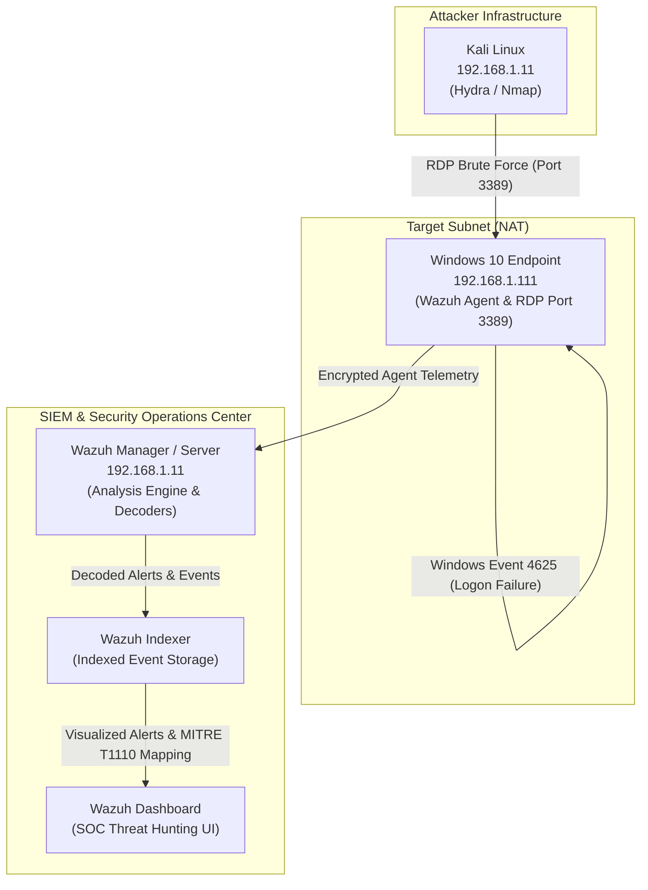

# Wazuh Windows Intrusion Detection & Threat Hunting Home Lab

A hands-on Cybersecurity & SOC Analyst lab environment built to deploy **Wazuh SIEM**, monitor a **Windows 10** endpoint, simulate **RDP brute-force attacks** using **Kali Linux & Hydra**, analyze Windows Event Logs (Event ID 4625), correlate security alerts, and map detection telemetry to the **MITRE ATT&CK Framework**.

---

## 📋 Table of Contents
1. [Project Overview](#-project-overview)
2. [Lab Architecture](#-lab-architecture)
3. [Technologies & Tools Used](#-technologies--tools-used)
4. [Step-by-Step Build Process](#-step-by-step-build-process)
5. [Wazuh Agent Configuration](#-wazuh-agent-configuration)
6. [Security Attack Scenarios & Detection](#-security-attack-scenarios--detection)
7. [Troubleshooting & Issues Resolved](#-troubleshooting--issues-resolved)
8. [Testing & Validation](#-testing--validation)
9. [Skills Demonstrated (Junior SOC Analyst)](#-skills-demonstrated-junior-soc-analyst)
10. [Lessons Learned & Future Improvements](#-lessons-learned--future-improvements)
11. [Hands-On Evidence & Artifacts](#-hands-on-evidence--artifacts)

---

## 🎯 Project Overview

### Purpose & Goals
The primary objective of this project was to gain practical, hands-on experience in building a SOC monitoring lab from scratch. Rather than relying on theoretical knowledge, this lab demonstrates:
- End-to-end deployment of **Wazuh SIEM** (Manager, Indexer, Dashboard) via Virtual Appliance (OVA).
- Installation and configuration of the **Wazuh Agent** on a target Windows 10 machine.
- Configuration of **Windows Audit Policies** (`auditpol`) to ensure security log generation.
- Execution of controlled adversary attack simulation (**RDP Brute Force**) from **Kali Linux**.
- Investigation of raw **Windows Event Viewer** events vs. correlated **Wazuh SIEM Security Alerts**.
- Mapping security alerts to **MITRE ATT&CK** tactics and techniques for threat analysis.

### SOC Relevance
In an enterprise Security Operations Center (SOC), security analysts do not manually inspect individual endpoint logs. They rely on SIEM platforms to centralize telemetry, normalize data, apply detection rules, correlate events, and surface actionable alerts. This lab replicates that real-world workflow.

---

## 🏗️ Lab Architecture

### Environment Components

| Role | OS / Appliance | IP Address | Details / Function |
| :--- | :--- | :--- | :--- |
| **SIEM Platform** | Wazuh OVA (v4.1.0) | `192.168.1.11` | Manager, Indexer, & Dashboard (Central log collection & detection engine) |
| **Target Endpoint** | Windows 10 | `192.168.1.111` | Monitored host running Wazuh Agent & target RDP service |
| **Attacker Machine** | Kali Linux | `192.168.1.11` | Attack box running Hydra & Nmap to simulate brute-force attacks |

> **Hypervisor**: VMware Workstation / VirtualBox  
> **Network Configuration**: Custom VMnet / NAT Subnet (`192.168.1.0/24`) ensuring isolated communication between VMs.

### Core Wazuh Architecture Components
1. **Wazuh Agent**: Installed on Windows 10. Runs **Agent Modules** (collects logs, FIM, system info) and **Agent Daemon** (transmits encrypted data to Manager).
2. **Wazuh Server / Manager**: Receives telemetry, parses raw logs through decoders, applies detection rule-matching, and correlates security events.
3. **Wazuh Indexer**: High-performance search and indexing database storing raw events, alert logs, and endpoint inventory data.
4. **Wazuh Dashboard**: Web user interface for SOC analysts providing threat hunting, MITRE ATT&CK mapping, alert visualization, and vulnerability tracking.

### Network & Data Flow Diagram (Mermaid)



---

## 🛠️ Technologies & Tools Used

- **SIEM & Endpoint Security**: Wazuh v4.1.0 (OVA Virtual Appliance)
- **Target OS**: Windows 10 Pro / Enterprise
- **Attacker OS**: Kali Linux
- **Virtualization**: VMware Workstation / VirtualBox
- **Attack Simulation Tools**:
  - `Hydra`: Network logon brute-force tool
  - `Nmap`: Network port and service scanner
- **Windows Administration & Security Tools**:
  - `PowerShell` (Administrator elevation)
  - `auditpol`: Audit policy management
  - `Windows Event Viewer` (`Security.evtx`, Event ID 4625)
  - `secpol.msc`: Local Security Policy editor
- **Threat Intelligence & Frameworks**:
  - `MITRE ATT&CK Framework`: Mapped to Credential Access (**TA0006**) / Brute Force (**T1110**)

---

## ⚙️ Step-by-Step Build Process

### Step 1: Deploying Wazuh SIEM Appliance
1. Downloaded the official **Wazuh OVA Virtual Appliance** (`v4.1.0` stable release).
2. Imported the OVA file into **VMware**:
   - Recommended specs: 4 vCPUs, 8 GB RAM (minimum 6 GB), 50 GB storage.
3. Configured network adapter to **Custom (VMnet0 / NAT)** to ensure internal connectivity.
4. Powered on the Virtual Machine and identified the Manager IP (`192.168.1.11`).
5. Accessed the **Wazuh Dashboard** via web browser at `https://192.168.1.11`.
   - Default login used for lab setup: `admin` / `admin` *(Security Note: Credentials must be updated in production environments)*.

### Step 2: Deploying Wazuh Agent on Windows 10
1. Verified network reachability between Windows 10 and Wazuh Manager via PowerShell:
   ```powershell
   ping 192.168.1.11
   ```
2. Navigated to **Wazuh Dashboard -> Deploy new agent**:
   - Selected OS: `Windows`
   - Entered Server Address: `192.168.1.11`
   - Assigned Agent Name: `Windows10`
3. Generated and executed the agent installation command in an **Elevated (Administrator) PowerShell** prompt:
   ```powershell
   Invoke-WebRequest -Uri https://packages.wazuh.com/4.x/windows/wazuh-agent-4.1.0-1.msi -OutFile wazuh-agent.msi
   msiexec.exe /i wazuh-agent.msi /q WAZUH_MANAGER='192.168.1.11' WAZUH_AGENT_NAME='Windows10'
   ```
4. Started and verified the Wazuh Agent Service:
   ```powershell
   Start-Service wazuh-svc
   Get-Service wazuh-svc
   ```

### Step 3: Configuring Windows Audit Policies
By default, Windows does not log failed logon attempts required for brute-force detection. Audit policy was enabled manually:
1. Checked current logon audit configuration:
   ```powershell
   auditpol /get /subcategory:"Logon"
   ```
2. Enabled logon auditing for both **Success** and **Failure**:
   ```powershell
   auditpol /set /subcategory:"Logon" /success:enable /failure:enable
   ```

### Step 4: Creating Test Account & Enabling RDP
1. Created a dedicated local user account for testing:
   ```powershell
   net user testuser Password123 /add
   ```
2. Enabled Remote Desktop (RDP):
   - `Settings` -> `System` -> `Remote Desktop` -> Toggle **On**.
3. Verified RDP listening status on port 3389:
   ```powershell
   Get-NetTCPConnection -LocalPort 3389
   ```

### Step 5: Adjusting Account Lockout Policy for Testing
Windows default security policy locks accounts after 10 failed logon attempts, stopping attack simulation prematurely.
1. Opened Local Security Policy: `win + r` -> `secpol.msc`.
2. Navigated to `Account Policies` -> `Account Lockout Policy`.
3. Set `Account lockout threshold` to `0` (disabled threshold for lab brute-force testing).
4. Unlocked test user account if previously locked:
   ```powershell
   net user testuser /active:yes
   ```

---

## 📝 Wazuh Agent Configuration

The Wazuh Agent configuration resides in `ossec.conf`.

- **File Path**: `C:\Program Files (x86)\ossec-agent\ossec.conf`
- **Editing Procedure**: Opened via Notepad launched from an Administrator PowerShell prompt:
  ```powershell
  notepad.exe "C:\Program Files (x86)\ossec-agent\ossec.conf"
  ```

### Monitored Event Log Channels
Verified that the Windows Event Log monitoring channels (`eventchannel`) were active for `Security`, `Application`, and `System` logs:

```xml
<localfile>
  <location>Security</location>
  <log_format>eventchannel</log_format>
</localfile>

<localfile>
  <location>Application</location>
  <log_format>eventchannel</log_format>
</localfile>

<localfile>
  <location>System</location>
  <log_format>eventchannel</log_format>
</localfile>
```

> **Service Reload Command**: Whenever changes are made to `ossec.conf`, the agent service must be restarted:
> ```powershell
> Restart-Service wazuh-svc
> ```

---

## ⚔️ Security Attack Scenarios & Detection

### Scenario 1: Baseline Single Failed Logon Test
To verify local event logging prior to running remote attacks:
1. Executed a local failed logon attempt via PowerShell:
   ```powershell
   net use \\127.0.0.1 /user:testuser wrongpassword123
   ```
   - **System Response**: `System error 1326 has occurred. (The user name or password is incorrect)`
2. **Local Windows Event Viewer Verification**:
   - Filtered `Security` log channel by Event ID `4625` (Audit Failure / Logon Failure).
   - Event Details: Target Account `testuser`, Failure Reason `Unknown user name or bad password`.
3. **Wazuh Dashboard Result**: Event ingested and visible under `Threat Hunting -> Events`.

### Scenario 2: RDP Brute-Force Attack Simulation (Kali Linux -> Windows 10)
1. **Reconnaissance from Kali Linux**:
   - Checked network interface IP: `ip a` (`192.168.1.11`).
   - Verified connectivity to target: `ping 192.168.1.111`.
   - Scanned target RDP port:
     ```bash
     nmap -p 3389 192.168.1.111
     ```
     *Output confirmed port 3389/tcp OPEN.*

2. **Wordlist Preparation**:
   - Created a custom wordlist containing incorrect test passwords:
     ```bash
     nano passwords.txt
     cat passwords.txt
     ```

3. **Attack Execution via Hydra**:
   ```bash
   hydra -l testuser -P passwords.txt rdp://192.168.1.111 -t 1
   ```
   > **Note on `-t 1`**: Restricts Hydra to a single thread/connection, preventing RDP service crashes and ensuring accurate event logging.

4. **Wazuh Detection & Alert Correlation**:
   - **Individual Log Ingestion**: Windows recorded multiple Event ID `4625` entries.
   - **Wazuh Correlation Rule Triggered**: As rapid logon failures occurred, Wazuh rule matching escalated single events into a high-severity alert:
     - **Alert Rule**: `Multiple Windows logon failures`
     - **Attacker Source IP**: `192.168.1.11` (Kali Linux)
     - **Target Account**: `testuser`
     - **Target Workstation**: `Windows10` (`192.168.1.111`)
     - **Event ID**: `4625`
   - **MITRE ATT&CK Mapping**:
     - **Tactic**: Credential Access (`TA0006`)
     - **Technique**: Brute Force (`T1110`)

---

## 🔧 Troubleshooting & Issues Resolved

### Problem 1: Wazuh Agent Service Failed to Start (`Service Name Invalid`)
- **Symptom**: Executing `net start wazuh-svc` returned `The service name is invalid`.
- **Root Cause**: PowerShell was executed as a standard user without administrative privileges.
- **Solution**: Relaunched PowerShell using **Run as Administrator**, re-ran the installer command, and started the service successfully using `Start-Service wazuh-svc`.

### Problem 2: Agent Status Showed "Disconnected" / Missing in Dashboard
- **Symptom**: Agent did not appear in the Wazuh Dashboard after installation.
- **Root Cause**: During deployment, the Windows 10 IP (`192.168.1.111`) was mistakenly entered as the Manager IP instead of `192.168.1.11`.
- **Solution**:
  1. Opened `C:\Program Files (x86)\ossec-agent\ossec.conf` as Administrator.
  2. Corrected the `<address>` XML tag to point to `192.168.1.11`.
  3. Restarted agent service: `Restart-Service wazuh-svc`.
  4. Confirmed agent status changed to **Active** in Wazuh Dashboard.

### Problem 3: Hydra Attack Interrupted by Account Lockout
- **Symptom**: Hydra attack failed after 10 attempts with connection error/lockout messages.
- **Root Cause**: Windows default Account Lockout Policy locked `testuser` after 10 failed attempts.
- **Solution**: Configured `secpol.msc` -> `Account Lockout Threshold = 0` (disabled threshold for testing), unlocked user via `net user testuser /active:yes`, and re-executed Hydra.

### Problem 4: Kali Couldn't Reach Windows Endpoint
- **Symptom**: Ping and Nmap requests timed out from Kali Linux.
- **Root Cause**: Windows Defender Firewall blocked ICMP and inbound connection probes.
- **Solution**: Temporarily disabled Firewall profiles on Windows 10 for the isolated lab environment.

---

## ✅ Testing & Validation

The lab workflow was validated through an end-to-end verification chain:

1. **Local Logging Validation**: Verified Windows Event Viewer recorded Event ID `4625` upon failed login.
2. **Configuration Validation**: Inspected `ossec.conf` to confirm `Security` channel monitoring was active.
3. **Agent Connectivity Validation**: Confirmed status `Active` in Wazuh Dashboard agent summary.
4. **Single Event Validation**: Ingested single failed logon event into Wazuh `Threat Hunting -> Events`.
5. **Correlation Alert Validation**: Verified multi-failure correlation rule generated high-severity `Multiple Windows logon failures` alert during Hydra attack.

---

## 🎓 Skills Demonstrated (Junior SOC Analyst)

- **SIEM & Endpoint Deployment**: Installing, configuring, and registering Wazuh Manager and Agents.
- **Windows Security Auditing**: Configuring audit policies via `auditpol` and interpreting Windows Event IDs (Event ID 4625).
- **Configuration Management**: Editing XML files (`ossec.conf`) and managing Windows services.
- **Adversary Emulation**: Utilizing penetration testing tools (`Hydra`, `Nmap`) to simulate realistic brute-force attacks.
- **Threat Hunting & Log Analysis**: Navigating SIEM dashboards, filtering by Source IP/User/Event ID, and differentiating raw events from correlated alerts.
- **Framework Alignment**: Mapping security events to **MITRE ATT&CK** tactics (`TA0006`) and techniques (`T1110`).
- **Hands-on Troubleshooting**: Debugging service errors, network firewall blocks, account lockouts, and IP misconfigurations.

---

## 📌 Lessons Learned & Future Improvements

### Lessons Learned
- **Events vs. Alerts**: A single failed login is an **Event** (e.g., user forgot password); multiple rapid failures from one source constitute an **Alert** (brute-force attack).
- **Log Dependency**: SIEM platforms can only detect what endpoints log—proper Windows Audit Policies are mandatory.
- **Defensive Controls**: Disabling Account Lockout was necessary for testing, but in production, lockout policies and rate limiting are critical primary defenses against brute-forcing.

### Future Improvements (Planned Upgrades)
> *Note: The following features are planned for future lab iterations and are not yet implemented in this version:*
- [ ] **File Integrity Monitoring (FIM)**: Configure `ossec.conf` to monitor sensitive Windows system folders and registry keys for unauthorized modifications.
- [ ] **Vulnerability Detection & SCA**: Enable Wazuh Security Configuration Assessment (SCA) and automated vulnerability scanning for Windows 10.
- [ ] **Active Response**: Configure automated active response scripts to dynamically block attacker IPs on Windows Firewall upon brute-force detection.
- [ ] **Custom Rules & Decoders**: Write custom XML detection rules for specialized log sources.
- [ ] **Multi-Vector Simulations**: Test Web application attacks, privilege escalation, and SSH brute-force on Linux endpoints.

---

## 📊 Hands-On Evidence & Artifacts

### Summary of Key Event Telemetry

| Telemetry Attribute | Observed Value |
| :--- | :--- |
| **Windows Event ID** | `4625` (Logon Failure - Audit Failure) |
| **Wazuh Correlation Alert** | `Multiple Windows logon failures` |
| **Target User** | `testuser` |
| **Target Hostname / IP** | `Windows10` / `192.168.1.111` |
| **Attacker IP** | `192.168.1.11` (Kali Linux) |
| **Attacking Tool** | `Hydra` (RDP protocol) |
| **MITRE ATT&CK Tactic** | Credential Access (`TA0006`) |
| **MITRE ATT&CK Technique** | Brute Force (`T1110`) |

### Key Commands Reference
```powershell
# Enable Windows Logon Auditing
auditpol /set /subcategory:"Logon" /success:enable /failure:enable

# Create Test User & Unlock
net user testuser Password123 /add
net user testuser /active:yes

# Check RDP Port Status
Get-NetTCPConnection -LocalPort 3389

# Manage Wazuh Agent Service
Start-Service wazuh-svc
Restart-Service wazuh-svc
Get-Service wazuh-svc
```

```bash
# Reconnaissance & Attack Simulation from Kali
nmap -p 3389 192.168.1.111
hydra -l testuser -P passwords.txt rdp://192.168.1.111 -t 1
```
